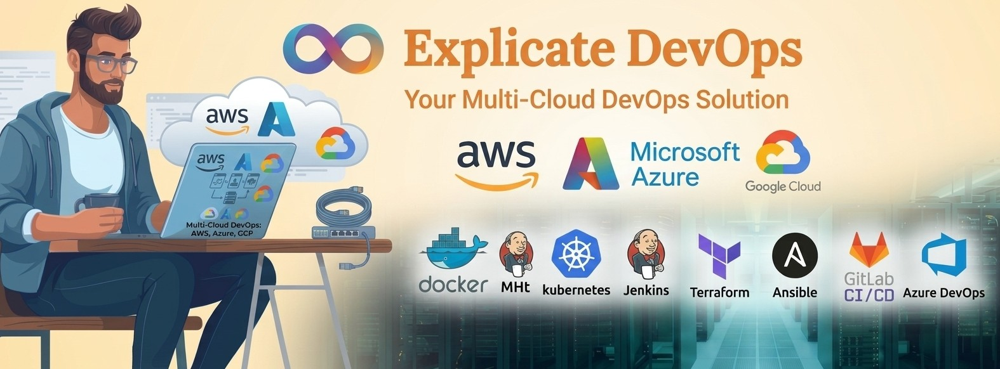

<div align="center">

## 👋 Meet Ritesh Kumar Singh

</div>

## 👨‍💻 About Me

I'm a passionate **Linux Administrator and Cloud DevOps Engineer** dedicated to making infrastructure robust, automated, and secure. Whether it's architecting multi-cloud environments on AWS, Azure, and GCP, or building seamless CI/CD pipelines and GitOps workflows, I love solving complex technical challenges.

Through my platform, **Explicate DevOps**, I actively share DevOps Projects, configuration guides for IT Organisations at no cost.

## 🎯 Mission & Approach

My core mission is **to help organizations implement DevOps in their projects with ease at no cost**.

### Linux Administrator cum Cloud DevOps Engineer · Explicate DevOps

<p align="center">
  <a href="https://github.com/singhritesh85" target="_blank">
    
  </a>
  <a href="https://linkedin.com/in/ritesh-kumar-singh-41113128b" target="_blank">
    
  </a>
  <a href="https://instagram.com/riteshkumarsingh9559" target="_blank">
    
  </a>
  <a href="https://x.com/singhriteshkum" target="_blank">
    
  </a>
</p>

---

<div align="center">
  
</div>

---

- 👨‍💻 **Projects:** [github.com/singhritesh85](https://github.com/singhritesh85)
- 💬 **Ask me about:** DevOps, DevSecOps, AWS, Azure, GCP, Kubernetes, and CI/CD
- 📧 **Email:** [riteshkumarsingh9559@gmail.com](mailto:riteshkumarsingh9559@gmail.com)

---

## 🛠️ Technologies & Tools

### Cloud, DevOps and Infrastructure

<p align="left">
  
</p>
<p align="left">
  
  
</p>

### DevOps Ecosystem

<p align="left">
  
  
  
  
  
  
  
</p>

---

## 🚀 Explicate DevOps Content

At **Explicate DevOps**, I create content about:

```text
├── Linux and Shell Scripting
├── Git, GitHub and GitLab
├── Jenkins, Azure DevOps and GitLab CI/CD
├── Docker and Containerization
├── Kubernetes, EKS, AKS and GKE
├── Terraform, OpenTofu and Ansible
├── AWS, Microsoft Azure and Google Cloud Platform
├── ArgoCD and GitOps
├── DevSecOps Tools and Practices
├── Prometheus, Grafana, Loki and OpenTelemetry
```


---

# 📊 GitHub Stats:
<br/>
<br/>


---

## 🤝 Open to Collaborations

<p>
  
  
  
</p>

- 🎤 Guest sessions and technical webinars
- 🤝 DevOps project collaborations
- 💼 DevOps consulting
- 🧭 Technical mentorship

---

## `You can connect with me`

<p align="center">
  <a href="https://linkedin.com/in/ritesh-kumar-singh-41113128b/">
  </a>
  <a href="https://instagram.com/riteshkumarsingh9559">
  </a>
  <a href=" https://x.com/singhriteshkum">
  </a>
  <a href="mailto:riteshkumarsingh9559@gmail.com">
  </a>
  
</p>

---

<div align="center">

### Helping Organisations to implement DevOps with ease in their projects.

```text
Build • Automate • Secure • Scale
```

**⭐ Follow [singhritesh85](https://github.com/singhritesh85) for practical DevOps projects**

</div>


## 🌐 Socials:
[](https://instagram.com/riteshkumarsingh9559) [](https://linkedin.com/in/riteshkumarsingh9559@gmail.com) [](https://x.com/singhriteshkum) [](mailto:riteshkumarsingh9559@gmail.com) 

# 💻 Tech Stack:
  

---
[](https://visitcount.itsvg.in)

<!-- Proudly created with GPRM ( https://gprm.itsvg.in ) -->
